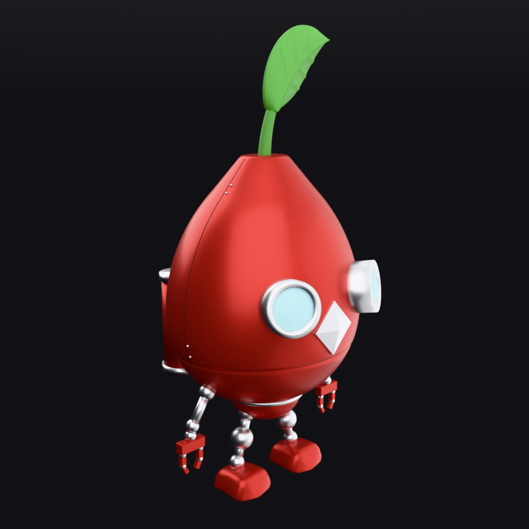
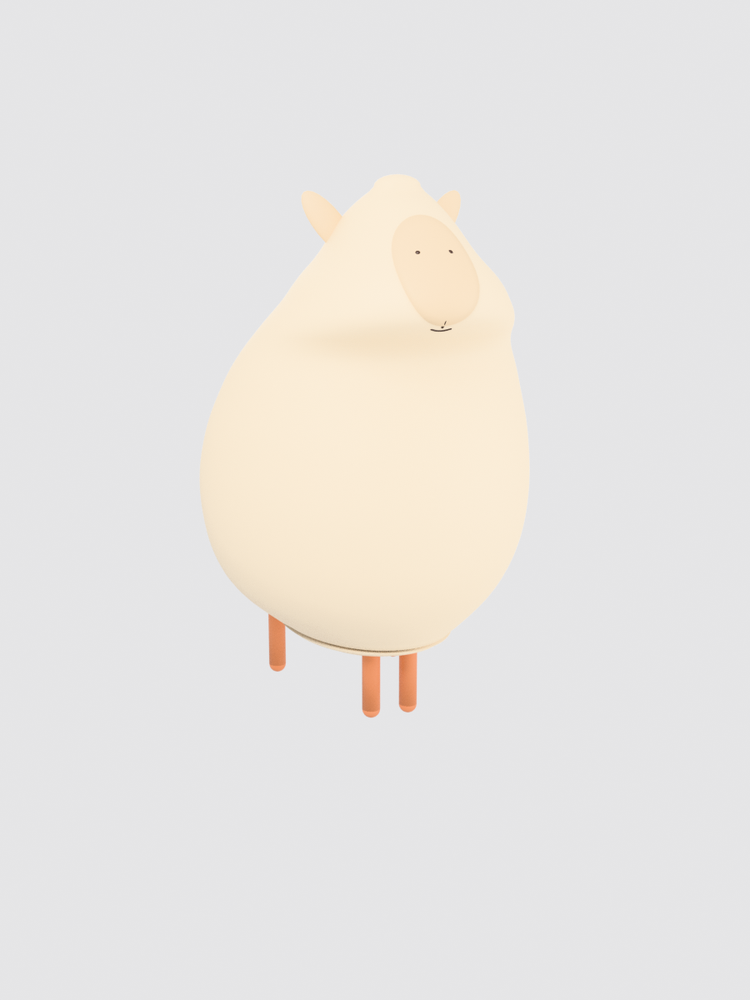
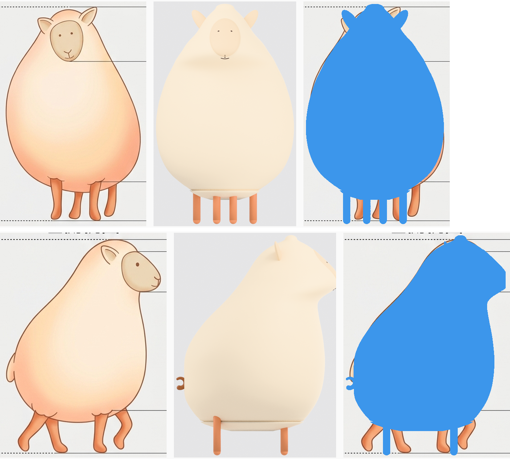

# 2D to 3D Skill Workflow

## 從 2D 四視圖到可編輯 3D：技能流程的建立、修正與跨角色驗證

這個專案記錄如何透過 AI 代理與 Blender Python，從角色四視圖建立可編輯的 3D 模型，並把實作中反覆遇到的問題整理成可複用的技能流程。

**植物機器人是起始專案，綿羊是修正後技能流的跨角色驗證。** 核心成果包括模型，以及素材檢查、參數化建模、渲染量測、版本管理和驗收規則。

| 起始專案：植物機器人 | 後續驗證：綿羊 |
|---|---|
|  |  |
| 逐版修正機械零件、外觀與接合，整理技能規則 | 換用不同角色，沿用流程重建並量測誤差 |

## 專案如何發展

### 1. 從機器人建模中建立方法

起始任務是依四張角色截圖，在 Blender 中重建紅色金屬植物機器人。先製作灰色水滴主殼，再分階段加入五官、莖葉、腿腳、手臂夾爪、背筒、材質及外殼細節。

過程中曾出現雞蛋狀主殼、局部修改引起整圈折角、扇形葉片、鼻子被曲面遮擋，以及板縫終點理解錯誤等問題。每次修正都保存版本，搭配同角度預覽與數值檢查，直到 v29 封存為 RELEASE v1。

[閱讀機器人案例與修正脈絡](docs/ROBOT_CASE.md)

### 2. 將失敗與修正沉澱成技能

實作教訓整理進 [`blender-automation`](skills/blender-automation/SKILL.md)，形成四個工作階段：

1. **素材品管**：檢查視圖比例、姿勢、方向與特徵，先量測再建模。
2. **腳本建模**：零件獨立命名、對稱件鏡像、另存版本並保護成功基準。
3. **逐版驗收**：分別確認幾何尺寸、渲染可見尺寸與輪廓；必要時比對渲染差異。
4. **凍結與交接**：收錄模型、腳本、視圖與版本說明，保留後續接手所需的資料。

這是一套提供給 AI 代理使用的工作規則與工具集合。不同角色仍需要重新量測及調整參數。

### 3. 用綿羊驗證流程能否延用

綿羊使用另一組四視圖，透過輪廓萃取、身體高度對齊、斷面掃掠、曲面色塊與材質取色，建立可編輯模型。案例包含 v1–v11 的迭代，最後封存為 RELEASE v1。



| 文件記錄的驗收項目 | 結果 |
|---|---|
| 正面輪廓平均絕對誤差 | **2.2%** |
| 側面輪廓平均絕對誤差 | **9.2%** |
| 臉部色塊高度／身高 | 原圖 0.171、模型 0.170 |
| 正式 Blender 檔物件數 | 78 個，獨立命名 |

側面原圖採走姿，模型採站姿，腿部差異是側面誤差的重要來源。這些是原專案的逐高度輪廓量測結果，不代表完整 3D 表面精度，也不是所有新角色的保證值。

[閱讀綿羊正式版說明](cases/sheep/release/RELEASE_v1.md) · [閱讀 2D → 3D 技術方法](docs/TECH_2D_TO_3D.md)

## 重建方法

正面剪影提供各高度的左右寬度，側面剪影提供前後深度。將兩者對齊後，沿高度連接一系列橢圓斷面，建立角色主體，再分別加入耳朵、腿、尾巴或機械零件。

輪廓先經預平滑及曲線內插，減少掃掠造成的條紋與環狀摺痕。材質從原圖區域取色，再分開檢查本色與打光結果。每次修改後重新輸出預覽並驗收。

## 儲存庫內容

```text
skills/blender-automation/   技能入口、驗收協定、素材 QC 與量測工具
docs/                       起始案例、技術方法、來源及執行說明
cases/robot/                成功基準模型、v29 正式模型、腳本與七張視圖
cases/sheep/                四視圖參考、v11 正式模型、GLB、腳本與九張視圖
tools/run_case.py           將原腳本路徑映射到本儲存庫的執行入口
build/                     本機重跑產物（不納入 Git）
```

直接下載即可用 Blender 開啟兩個 `release/` 目錄中的 `.blend` 檔；綿羊另附 `.glb` 格式。

## 執行方式

原專案環境為 Blender **5.0.1**、Cycles CPU；像素量測工具使用系統 Python 與 Pillow。請在儲存庫根目錄執行：

```bash
# 由已附的 BASELINE 重建機器人 v29 外殼細節
blender -b -P tools/run_case.py -- robot build

# 從新產生的機器人模型輸出視圖
blender -b -P tools/run_case.py -- robot render

# 由內嵌量測表建立綿羊模型並渲染
blender -b -P tools/run_case.py -- sheep build
```

輸出寫入 `build/robot/` 或 `build/sheep/`。執行入口保留原始腳本，以執行時路徑映射處理原 WSL 路徑。

機器人 v29 依賴已完成的 BASELINE；本儲存庫提供這個依賴，未收錄從空場景產生 BASELINE 的完整歷史鏈。綿羊腳本內含本角色的輪廓表，替換圖片仍需重新量測與設定。

[詳細重現方式與驗證範圍](docs/REPRODUCING.md)

## 適用範圍

已展示的能力是四視圖驅動的外形重建，適合輪廓清楚、主體接近凸形的角色。兩個正交輪廓無法唯一決定立體形狀；橢圓斷面是工程假設，複雜凹面、遮擋、多層衣物仍需額外約束與建模。

目前沒有驗證任意單張圖片的一鍵轉換，也未包含骨架綁定、動畫或遊戲資產規格驗收。

## 來源與版本

資料來自植物機器人的原始對話與交接文件、兩個正式交付包，以及後續修正的技能文件。本次整理不包含完整聊天紀錄；詳細來源與驗證界線見 [PROVENANCE](docs/PROVENANCE.md)。

本儲存庫未新增授權條款；角色素材、模型與程式碼的授權需由專案擁有者另行指定。
