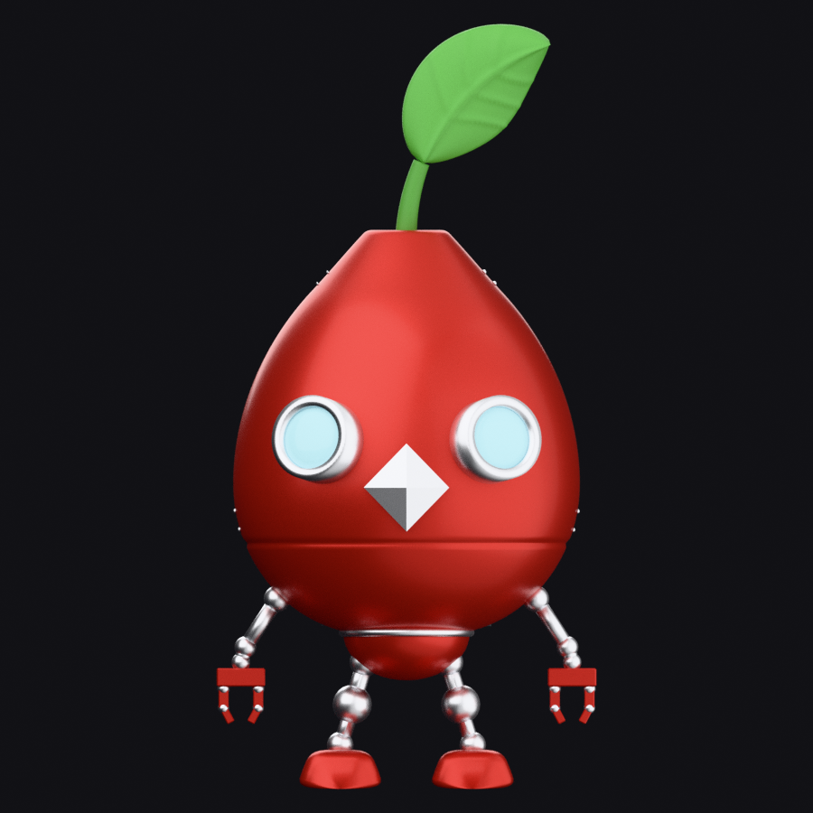
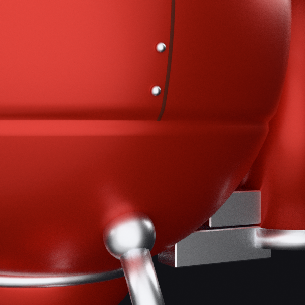

# 起始案例：紅色金屬植物機器人

## 任務與交付

依正面、背面、左右側面四張參考圖，建立真正可編輯的 Blender 模型。主體是一體成形的水滴外殼，另含銀色眼框、淡青鏡片、菱形鼻、莖葉、機械四肢、背筒與板縫鉚釘。

原始對話記錄從 2026-09-24 開始，主要收錄至 v12。後續交接文件補充 v13–v29 的修正；正式交付說明記載於 2026-09-26 凍結 v29 為 RELEASE v1。

## 問題如何轉成技能規則

| 問題與版本 | 修正方法 | 可複用規則 |
|---|---|---|
| v1 主殼像雞蛋，v2 出現頸部與肩膀 | 調整最寬截面位置與上半部連續凸弧 | 先確認主輪廓，再加零件；平滑著色不能代替幾何 |
| v7 修改接縫時造成遠處折角 | v8 限定修改作用範圍，檢查與 v6 的輪廓差異 | 局部編輯需同時驗證未打算改動的形狀與尺寸 |
| v9 葉片變成扇形 | v10 改以葉根、中央葉脈與葉尖建立結構 | 投影尺寸不足以定義零件，需補上結構約束 |
| v22 鼻子尺寸存在但大部分被遮住；v23 可見輪廓再次內凹 | v24 保持平面菱形框，整組前移並以裙邊接回曲面 | 本身尺寸、實際可見尺寸、外輪廓須分別檢查 |
| v25–v27 板縫終點誤解 | 標註 A/B 候選位置，確認後重建至水平凹槽；v29 用渲染差異驗收 | 部位名稱有歧義時先標註，完成後檢查實際渲染 |

## 具體驗收證據

以下為交接文件記錄，整理時未重新計算全部歷史指標。

- 手臂 v16：左右鏡像誤差 0，八組接合 overlap > 0。
- 頂部 v21：頂緣法線夾角由 77.6° 降至 11.7°，大於 12° 的銳邊由 96 降至 0；主殼高度與最大寬度維持不變。
- 鼻子 v24：投影凸包保留四頂點與四條直邊；突出深度約 0.0809，檢查外框可見與裙邊接合。
- 板縫 v29：終點 z = −0.7290，每側四顆鉚釘；兩側板縫最低可見列與目標投影列同為 238px。

這些數值屬於本角色的設定與實測，不能直接當作其他角色的通用標準。

## 最後得到什麼

最終產出包括可編輯的正式模型、可保護的 BASELINE、v29 細節生成腳本與七張視圖。修正經驗整理成技能的驗收協定與素材檢查規則，後續再透過綿羊檢驗流程能否延用。

正式版仍保留部分與原圖的差異，包括刻意指定的身體／眼距／鼻子比例，以及夾爪細節、葉片姿態與未製作的背筒標誌。完整資訊見[正式版說明](../cases/robot/release/RELEASE_v1.md)。
